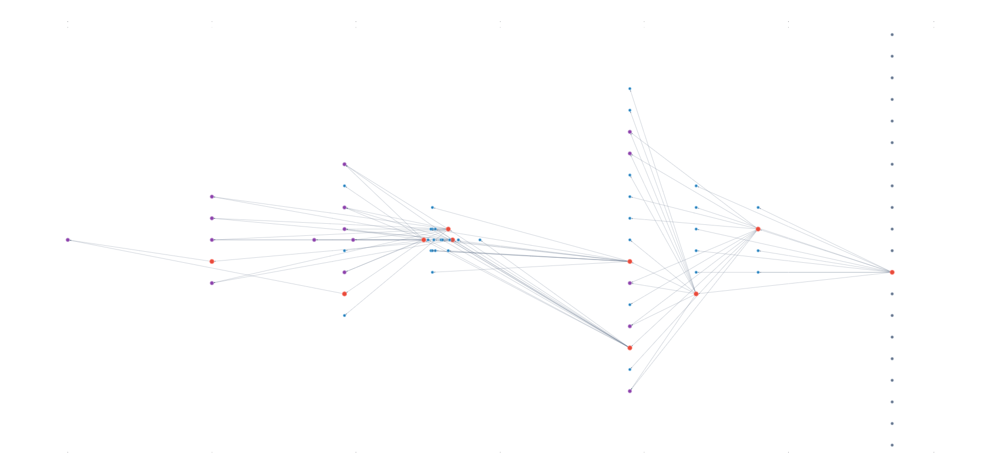

# Semantic Search Across Historical Texts

Built upon [mutatis-mutandis-passage-search](https://github.com/leegee/mutatis-mutandis-passage-search)

> [!NOTE]  
> [Case study](./docs/case_study.md).

From a Postgres database of document metadata and tokens extracted from TEI XML and plain text, 
uses various layers of various scales of embeddings created by Manjavacas and Fonteyn's historical BERT model 
[MacBERTh](https://aclanthology.org/2021.nlp4dh-1.4/) that are stored in and searched through Lance via a Python 
FastAPI/SolidJS application.

A sample dataset, and indeed Lance indexes, are available upon request.

## Motivation

> We all declare for liberty but in using the same word we do not all mean the same thing
> -- Abraham Lincoln, Address at the Sanitary Fair in Baltimore, Maryland, on April 18, 1864

**How can historical references be found to the people - like yours truly - who modern clinicians refer to as albinos, when the term was not coined until at earliest the 1650s?**

## Usage Synopsis

### Ingestion

To add a doc to the corpus:

```bash
    cd backend
    # Ingest all corpora:
    python src/mutatis_mutandis/ingest/ingest.py

    # Ingest one predefined corpus:
    python src/mutatis_mutandis/ingest/ingest.py --corpus eebo
    # Ingest one document from a predefined corpus:
    python src/mutatis_mutandis/ingest/ingest.py --file temp/enoch_charles_1917.xml --corpus misc

    # Create a package from which Colab can create embeddings of whole documents:
    python src/mutatis_mutandis/embed/passages_1_export_full.py
    # Create a package from which Colab can create embeddings of document fragments that match predefined seed terms:
    python src/mutatis_mutandis/embed/passages_1_export_windows.py 

    # Run on Colab passages_2_0_colab_embed_passages.py 
    
    # Take the Colab embeddings from remote storage into local Lance:
    python src/mutatis_mutandis/embed/passages_3_passages_parquet_to_lance.py
```

## API/GUI

Run the search servers from the root:

    ./start-servers.sh

## Agents

### [`src/diachronic_agents/experiments/reverse_albinism.py`](backend/src/diachronic_agents/experiments/reverse_albinism.py)



### [`src/diachronic_agents/experiments/forward_albinism.py`](backend/src/diachronic_agents/experiments/forward_albinism.py)


