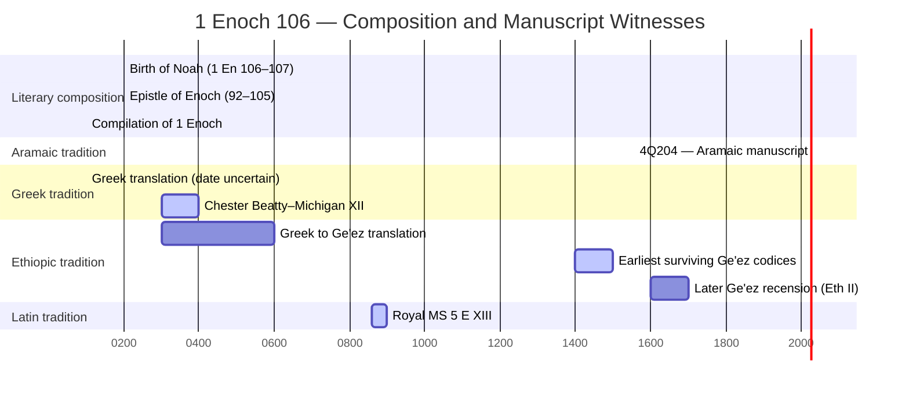

# 1 Enoch 106 - Noah's birth and extraordinary appearance

**Passage:** 1 Enoch 106:1–3 (focus on 106:2)
**Languages/witnesses:** Aramaic fragmentary evidence; Greek; Geʿez; later Latin transmission
**Status:** Important dossier; keep each witness distinct.

## Narrative context

Noah's birth is presented as extraordinary and alarming. His father Lamech reacts with fear and suspicion, wondering whether the child is not his own and whether the appearance might indicate supernatural parentage. The narrative gives the physical description a role in the plot: the appearance provokes interpretation and anxiety.  

[Britannica](https://www.britannica.com/topic/biblical-literature/The-Book-of-Enoch#ref597939) on 1 Enoch: 

> _I Enoch_ is a [compilation](https://www.merriam-webster.com/dictionary/compilation) of several separate works, most of which are apocalyptic. Its oldest portion is the “Apocalypse of Weeks,” written shortly before the Maccabean uprising of 167 bc against the Seleucids. Other sections, especially those dealing with astronomical and cosmological speculations, are difficult to date. Because of its views on messianism, celibacy, and the fate of the soul after death, parts of _I Enoch_ may have originated with or been influenced by the [Essene](https://www.britannica.com/topic/Essene) [community](https://www.merriam-webster.com/dictionary/community) of Jews at [Qumrān](https://www.britannica.com/place/Qumran). No fragments of the longest portion of the work (chapters 37–71), however, were found among the Qumrān writings. This has led scholars to theorize that this section was perhaps written in the 2nd century ad by a Jewish Christian who wished to imbue his own eschatological speculations with the authority of Enoch, and added his work to four older apocryphal Enoch writings.
>
> _I Enoch_ was at first accepted in the Christian Church but later excluded from the [biblical canon](https://www.britannica.com/topic/biblical-canon). Its survival is due to the fascination of [marginal](https://www.britannica.com/dictionary/marginal) and heretical Christian groups, such as the Manichaeans, with its syncretic blending of Iranian, Greek, Chaldean, and Egyptian elements.

**Loren T. Stuckenbruck**'s _1 Enoch 91–108._ in *Commentaries on Early Jewish Literature*, De Gruyter (2007).  A commentary on precisely the section we are studying presents the Ethiopic and English texts synoptically and discusses differences between versions.

```mermaid

flowchart TD

    %% MAIN NARRATIVE
    subgraph NARRATIVE["1 ENOCH 106 — THE NARRATIVE"]
        direction TB
        A["106:1 — Birth of Noah"]
        B["106:2 — Extraordinary physical appearance"]
        C["106:3 — Speaks to the Lord<br/>with righteousness"]
        D["106:4–6 — Lamech's fear<br/>Suspects supernatural parentage"]
        E["106:7–8 — Lamech reports<br/>the birth to Methuselah"]
        F["106:9–10 — Methuselah approaches Enoch<br/>with anxiety and a disturbing vision"]
        G["106:11–12 — Methuselah repeats<br/>the description and concern"]
        H["106:13–18 — Enoch explains<br/>the birth and Noah's destiny"]

        A --> B --> C --> D --> E --> F --> G --> H
    end

    %% PHYSICAL DESCRIPTION
    subgraph APPEARANCE["NOAH'S PHYSICAL DESCRIPTION — 106:2"]
        direction TB
        P1["BODY — WHITE<br/>White as snow"]
        P2["BODY — RED<br/>Red as a blooming rose"]
        P3["HAIR<br/>Hair and long locks<br/>white as wool"]
        P4["EYES<br/>Beautiful"]
        P5["LIGHT<br/>Opens his eyes<br/>Illuminates the whole house<br/>like the sun"]
    end

    B -.-> P1
    B -.-> P2
    B -.-> P3
    B -.-> P4
    B -.-> P5

    %% REPORTED SPEECH
    subgraph SPEECH["REPETITION AND REPORTED SPEECH"]
        direction TB
        R1["LAMECH<br/>Describes Noah to Methuselah<br/>106:5–8"]
        R2["METHUSELAH<br/>Repeats the description to Enoch<br/>106:11–12"]
        R3["ENOCH<br/>Interprets the birth<br/>106:13–18"]
        R1 --> R2 --> R3
    end

    E -.-> R1
    G -.-> R2
    H -.-> R3

    %% TEXTUAL WITNESSES
    subgraph WITNESSES["TEXTUAL WITNESSES — DISTINCT TRANSMISSION"]
        direction TB

        subgraph ARAMAIC["ARAMAIC — 4Q204 FRAGMENT 5"]
            direction TB
            AR1["106:1–2<br/>Beginning of birth description<br/>Fragmentary preservation"]
            AR2["šmwq — RED<br/>Reported surviving word"]
            AR3["Other wording<br/>Restoration and lacunae<br/>require manuscript verification"]
            AR1 --> AR2
            AR1 --> AR3
        end

        subgraph GREEK["GREEK — CHESTER BEATTY–MICHIGAN XII"]
            direction TB
            GR1["106:2 — BODY<br/>λευκότερον χιόνος<br/>Whiter than snow"]
            GR2["106:2 — BODY<br/>πυρρότερον ῥόδου<br/>Redder than a rose"]
            GR3["HAIR<br/>λευκότερον ἐρίων λευκῶν<br/>Whiter than white wool"]
            GR4["Editorial restoration<br/>Clause concerning appearance<br/>unlike other men"]
            GR1 --> GR2 --> GR3
        end

        subgraph GEZ["GE'EZ — COMPLETE SURVIVING TEXT"]
            direction TB
            GE1["106:2<br/>Full birth description"]
            GE2["Body: white as snow<br/>and red as a blooming rose"]
            GE3["Hair: white as wool<br/>Eyes: beautiful"]
            GE4["Eyes open<br/>House illuminated like the sun"]
            GE1 --> GE2 --> GE3 --> GE4
        end

        subgraph LATIN["LATIN — ROYAL MS 5 E XIII"]
            direction TB
            LA1["Fragmentary Latin transmission<br/>106–107"]
            LA2["Abbreviated and reworked tradition<br/>Not a complete equivalent<br/>of the Ge'ez"]
            LA1 --> LA2
        end
    end

    %% LINK TEXT TO WITNESSES
    P1 -.-> GR1
    P2 -.-> GR2
    P3 -.-> GR3
    P1 -.-> AR1
    P2 -.-> AR2
    B -.-> GE1

    %% COLOUR LEXICON
    subgraph LEXICON["COLOUR VOCABULARY — COMPARATIVE EVIDENCE"]
        direction TB
        L1["ARAMAIC<br/>šmwq<br/>Red"]
        L2["GREEK<br/>πυρρός<br/>Red / ruddy"]
        L3["GE'EZ<br/>Red terminology<br/>qyḥ in Noegel's citation<br/>Exact lexical correspondence to verify"]
        L4["GE'EZ WHITENESS<br/>ጸዐዳ — ṣəʿəda<br/>Spelling and lexical history<br/>to verify"]
        L5["COMPARISON<br/>White + red<br/>Body contrasted with<br/>white wool-like hair"]
        L1 -.-> L2
        L2 -.-> L3
        L3 -.-> L5
        L4 -.-> L5
    end

    AR2 -.-> L1
    GR2 -.-> L2
    GE2 -.-> L3
    GE2 -.-> L4

    %% RELATED TEXTS
    subgraph PARALLELS["RELATED TEXTS AND INTERPRETATIVE CONTEXT"]
        direction TB
        T1["GENESIS APOCRYPHON — 1Q20<br/>Noah's extraordinary birth<br/>Lamech's suspicion<br/>Solar and flame imagery"]
        T2["4Q534–536<br/>Elect of God / possible Noah tradition<br/>Identification remains debated"]
        T3["DANIEL 7:9<br/>Hair like pure wool"]
        T4["DANIEL 10:6<br/>Eyes like flaming torches"]
        T5["APOCALYPSE OF PETER 3<br/>White and ruddy bodies<br/>Possible literary reception"]
    end

    R1 -.-> T1
    B -.-> T2
    P3 -.-> T3
    P4 -.-> T4
    P5 -.-> T1
    P2 -.-> T5

    %% INTERPRETATION
    subgraph INTERPRETATION["INTERPRETATIVE QUESTIONS"]
        direction TB
        I1["Does white + red describe<br/>an unusual human complexion?"]
        I2["Is the appearance associated<br/>with theophanic imagery?"]
        I3["How do translation and transmission<br/>affect the physical description?"]
        I4["Does the narrative distinguish<br/>physical appearance from<br/>perceived supernatural origin?"]
    end

    P1 -.-> I1
    P2 -.-> I1
    P3 -.-> I2
    P5 -.-> I2
    WITNESSES -.-> I3
    D -.-> I4
    H -.-> I4

    %% DARK THEME PALETTE
    classDef narrative fill:#26394b,stroke:#7297b5,color:#f0f4f8,stroke-width:1.5px
    classDef appearance fill:#493b27,stroke:#c6a56b,color:#fff1d6,stroke-width:1.5px
    classDef speech fill:#303d35,stroke:#83a88c,color:#e4f1e5
    classDef aramaic fill:#293b43,stroke:#75a6ae,color:#e3f3f5
    classDef greek fill:#34344a,stroke:#9996c7,color:#eeeeff
    classDef gez fill:#304336,stroke:#83ad8c,color:#e5f3e7
    classDef latin fill:#453548,stroke:#ad8db5,color:#f3e8f5
    classDef lexicon fill:#493b27,stroke:#c6a56b,color:#fff1d6
    classDef parallel fill:#423247,stroke:#ae8bb8,color:#f5e8f7
    classDef interpretation fill:#303b49,stroke:#8da9c3,color:#edf3f9

    class A,B,C,D,E,F,G,H narrative
    class P1,P2,P3,P4,P5 appearance
    class R1,R2,R3 speech
    class AR1,AR2,AR3 aramaic
    class GR1,GR2,GR3,GR4 greek
    class GE1,GE2,GE3,GE4 gez
    class LA1,LA2 latin
    class L1,L2,L3,L4,L5 lexicon
    class T1,T2,T3,T4,T5 parallel
    class I1,I2,I3,I4 interpretation

```

## 1 Scant Aramaic evidence

According to Stuckenbruck and the standard editions, fragment 5 contains:

| Location            | Ethiopic equivalent | Status                     |
| ------------------- | ------------------- | -------------------------- |
| col. i, lines 20–24 | 104:13–105:2        | Preserved (end of Epistle) |
| col. i, lines 26–28 | **106:1–2**         | Preserved (with lacunae)   |
| col. ii             | **106:13–107:2**    | Preserved (with lacunae)   |
So the **beginning** of the birth description (106:1–2: "bore him a son… his body was white as snow…") and the **end** (106:13–107:2: the deluge aftermath) are on the fragment. The **middle** (106:3–12, Lamech's fear, his dialogue with Methuselah) is **lost** . It would have occupied lines 29–43 of the column, which are not preserved.

The best indication comes from **Schiffman's translation** (in [_Reclaiming the Dead Sea Scrolls_](https://cojs.org/enoch-_lawrence_h-_schiffman-_reclaiming_the_dead_sea_scrolls-_jewish_publication_society-_philadelphia_1994/), JPS, 1994), which uses brackets for restored text:

> "\[And when the boy was born, his flesh was whiter than snow and] **redder** \[than a rose, and all his hair was as white as pure wool, and thick and bright. And when he opened his eyes he illumined the] **entire** \[house like the sun, and the whole house was very bright]."  

-- labeled **4QEnᶜ 5 i:28–30 = 1 En 106:2**

Some report the words actually visible on the fragment appear to be only **"redder"** (i.e., **šmwq**) and **"entire"**, the rest of the line is Milik's restoration from the Ethiopic. This is unclear and needs work.  See [here](https://textorah.org/1-enoch/106/).

**Henryk Drawnel**'s  2019 updated edition, [_Qumran Cave 4: The Aramaic Books of Enoch._](https://www.nli.org.il/en/systemlibrary/umbracoitempage?docId=NNL_ALEPH997009971868305171&lang=he&type=books&vid=NLI) (Oxford University Press, DJD 52) includes manuscript photographs, transcription, grammatical and textual notes, reconstructions and comparison with the other versions. 

## 2 Geʿez evidence

[[Ge'ez 1 Enoch tradition]]

The Geʿez tradition is the oldest complete surviving form of 1 Enoch, but that does not make it the earliest physical witness. Prior discussion noted the use of `ጸዐዳ` (*ṣəʿəda*, spelling/transliteration to verify) rather than a form expected from the Semitic root often represented as *l-b-n*. This is a lexical question for further investigation, not yet an explanation.

The earliest Ethiopic manuscripts date to the **14th century**, though the translation is generally placed in the **4th–7th century** (Knibb, _The Ethiopic Version of Enoch_, 1978) via https://larryhurtado.wordpress.com/2019/10/06/1-enoch-an-update-on-manuscripts-and-cautionary-notes-on-usage/

- The word **"red"** in v. 2 is the Ethiopic rendering of the Aramaic **šmwq** — the same word form that means "furnace" in 10:13. The Ethiopic here uses the adjective sense ("red as a rose"), confirming the dual meaning.
- The description is **repeated** in vv. 7 and 11 (Lamech recounts it to Methuselah, then Methuselah recounts it to Enoch) — a narrative device, not a textual duplication.

[Older primary source](https://www.encyclopedia.com/religion/encyclopedias-almanacs-transcripts-and-maps/enoch-ethiopic-book) for the Ethiopic text: R. H. Charles, _The Ethiopic Version of the Book of Enoch_ (Oxford: Clarendon, 1906), based on 23 manuscripts. The most recent critical edition is in **Stuckenbruck, _1 Enoch: Chapters 91–108_** (de Gruyter, 2007), pp. 617–665.

Current primary source is **Michael A. Knibb**, _The Ethiopic Book of Enoch: A New Edition in the Light of the Aramaic Dead Sea Fragments._, 2 vols., Oxford: Clarendon Press  (1978).

#### The full Ethiopic text of 1 Enoch 106
 
 Standard academic verse numbering, following Charles 1917 / the 1906 Ethiopic edition:
 https://rl.thebookofenoch.info/

> **1** And after some days my son Methuselah took a wife for his son Lamech, and she became pregnant by him and bore a son.
> 
> **2** **And his body was white as snow and red as the blooming of a rose, and the hair of his head and his long locks were white as wool, and his eyes beautiful. And when he opened his eyes, he lighted up the whole house like the sun, and the whole house was very bright.**
> 
> **3** And when he arose from the hands of the midwife, he opened his mouth and spoke to the Lord with righteousness.
> 
> **4** And his father Lamech was afraid of him and fled and went to Methuselah his father.
> 
> **5** And he said to him: "I have begotten a strange son; he is not like an (ordinary) human being, but he looks like the children of the angels of heaven to me; his form is different, and he is not like us. His eyes are like the rays of the sun, and his face glorious."
> 
> **6** "I am afraid lest he be not sprung from me but from the angels."
> 
> **7** "And now, my father, hear me: unto Lamech my son there hath been born a son, the like of whom there is none, and his nature is not like man's nature, and the colour of his body is whiter than snow and redder than the bloom of a rose, and the hair of his head is whiter than white wool, and his eyes are like the rays of the sun, and he opened his eyes and thereupon lighted up the whole house."
> 
> **8** "I am come to you, my father, that you might point out to me the truth."
> 
> **9** And Enoch said: "Behold, here am I, my son, wherefore hast thou come to me?"
> 
> **10** And he answered and said: "Because of a great cause of anxiety have I come to thee, and because of a disturbing vision have I approached."
> 
> **11** And now, my father, hear me: unto Lamech my son there hath been born a son… _(repetition of the physical description)_
> 
> **12** His father Lamech feared, and fled to me, believing not that the child belonged to him, but that he resembled the angels of heaven. And behold I am come to you, that you might point out to me the truth.
> 
> **13** Then I, Enoch, answered and said: The Lord will effect a new thing upon the earth. This have I explained, and seen in a vision. I have shown you that in the generations of Jared my father, those who were from heaven disregarded the word of the Lord. Behold they committed crimes; laid aside their class, and intermingled with women. With them also they transgressed; married with them, and begot children.
> 
> **14** And his posterity shall beget on the earth giants, not spiritual, but carnal. Upon the earth shall a great punishment be inflicted, and it shall be washed from all corruption.
> 
> **15** A great destruction therefore shall come upon all the earth; a deluge and a great destruction for one year.
> 
> **16** And this son who has been born unto you shall be left on the earth, and his three children shall be saved with him, when all mankind that are on the earth shall die.
> 
> **17** And on the earth there will be a great punishment, and the earth will be cleansed from all corruption.
> 
> **18** And now make known to thy son Lamech that he who has been born is in truth his son, and call his name **Noah**; for he shall be left to you, and he and his sons shall be saved from the destruction which shall come upon the earth on account of all the sin and oppression that existed, and it will be fulfilled upon the earth, in his days.

## Greek witness — reported wording

The Chester Beatty–Michigan Papyrus XII is reported to preserve the passage. The Greek description includes:

- `λευκότερον χιόνος` — “whiter than snow”;
- `πυρρότερον ῥόδου` — “redder than a rose”;
- hair described with `λευκότερον ἐρίων λευκῶν` — “whiter than white wool”.

The exact diplomatic transcription, lineation, and punctuation must be checked against the edition.

An angle-bracketed clause commonly represented as `⟨οὐχ ὅμοιος ἀνθρώποις καὶ τὸ χρῶμα αὐτοῦ⟩` (“and his complexion/colour was unlike that of men”) has been reported as editorial restoration, not securely legible manuscript text. 

**Campbell Bonner**'s _The Last Chapters of Enoch in Greek._, Studies and Documents VIII (1937).

This is the original scholarly edition of Chester Beatty–Michigan Papyrus XII. 

## Colour pairing and relevance to the current question

The Greek wording in 106:2 is **λευκότερον χιόνος καὶ πυρρότερον ῥόδου** (*leukoteron chionos kai pyrroteron rhodou*), “whiter than snow and redder than a rose.” The description concerns Noah’s **body**; the text then describes his hair as whiter than white wool. The same paired body-colour description recurs in 106:10.

This is a close poetic and conceptual parallel to the present discussion of Song of Songs 5:10 and Lamentations 4:7: a human body is described through whiteness and redness, with the red shade articulated by comparison to a rose. It makes a rosy or pinkish reading of red human appearance in ancient literary description easier to take seriously. It is **not** an occurrence of the Hebrew adjective אָדֹם, however: the extant Greek uses πυρρός (“red/ruddy”), and the fragmentary Aramaic witness preserves only its own word for “red.” Treat it as comparative evidence for the imagery and colour range, not as direct Hebrew lexical evidence or proof that all three texts intend the same shade.

The Qumran witness is incomplete: 4Q204 preserves a fragmentary red term in the Noah description, while the full snow/rose comparison is known through the Greek and Ethiopic textual traditions. The Greek clause sometimes printed in brackets about Noah’s colour/appearance being unlike other people is editorially restored in the cited Greek witness and must remain distinguished from the securely visible text.

For the Greek and Aramaic comparison, see Kelley Coblentz Bautch, “Peter and the Patriarch: A Confluence of Traditions?,” in *With Letters of Light* (2011), pp. 24–26. Bautch prints the Greek wording, notes the red word surviving in 4QEnᶜ, and cautions that the significance of this unusual white-and-red complexion remains unresolved.

Robert Noegel's 2016 article, _Scarlet and Harlots: Seeing Red in the Hebrew Bible_,Footnote 46:

> The Ethiopic version of the Book of Enoch states that when Noah was born his body was “as white as snow and red (qyḥ) like a rose” (106:2, 106:10), a reference that the **Apocalypse of Peter** (v. 3) appears to have adopted to describe two figures whose bodies were white and “ruddy” (έρυθρότερα). Observed already by R. H. Charles, The Book of Enoch (Oxford: Clarendon Press, 1893), 302–3, n. 10. See Michael A. Knibb and Edward Ullendorff, The Ethiopic Book of Enoch: A New Edition in the Light of the Aramaic Dead Sea Fragments (Oxford: Clarendon Press, 1978), vol. 1, 408; vol. 2, 245. Note that 4QEnc 5 i 28 reads “ ,שמוקred.” On slight variants in the Ethi- opic fragments, see Loren T. Stuckenbruck, 1 Enoch 91–108 (Berlin: Walter de Gruyter, 2007), 623–24. A fragmentary text from Qumran (4Q534:1) also uses the term “ ,שׂמקמק reddish,” likely in reference to Noah’s body at birth.

## Sources

- Kelley Coblentz Bautch, “Peter and the Patriarch: A Confluence of Traditions?,” in Daphna Arbel and Andrei A. Orlov (eds.), *With Letters of Light: Studies in the Dead Sea Scrolls, Early Jewish Apocalypticism, Magic, and Mysticism in Honor of Rachel Elior* (Leiden: Brill, 2011), 23–38, especially 24–26. [Publisher preview](https://api.pageplace.de/preview/DT0400.9783110222029_A15531968/preview-9783110222029_A15531968.pdf).

- **Milik, _The Books of Enoch: Aramaic Fragments of Qumrân Cave 4_** (Oxford: Clarendon, 1976), **pp. 210–217** (4Q204 frg. 5 specifically), with plates IX–XV.

- **Drawnel, _Qumran Cave 4: The Aramaic Books of Enoch_ (DJD 52)** (Oxford: OUP, 2019), **pp. 286–308** (4Q204 frg. 5), with updated transcriptions and text-critical notes.
## Research hypotheses to keep separate

- A Semitic source may underlie the Greek and Geʿez forms.
- Translation and transmission may have sharpened, clarified, or expanded the colour description.
- The Aramaic *min* construction and its relation to comparative or source/origin senses require close grammatical analysis. The user's proposed reading should be recorded as a hypothesis, not silently normalised into a settled translation.
- The narrative's shock and suspicion may have encouraged later interpreters or translators to add clarifying details.

## Questions

1. What is the exact extent of 4Q204 fragment 5 at this point in the text?
2. Which letters are visible, and which are restored?
3. What is the Greek papyrus's exact reading and what is editorially supplied?
4. Does the Geʿez wording reflect a translation equivalent, a different Vorlage, or a lexical convention?
5. What can be dated: composition, Aramaic copying, Greek translation, Greek papyrus, Geʿez translation, and surviving Geʿez codices?

## Related notes

- [[4Q204 - Aramaic Enoch witness]]
- [[Chester Beatty-Michigan Papyrus XII - Greek Enoch witness]]
- [[Royal MS 5 E XIII - Latin Enoch witness]]
- [[Colour vocabulary and comparison]]
- [[Transmission chronology]]

# Resources

- [Online Critical Pseudepigrapha – 1 Enoch](https://pseudepigrapha.org/reader.html?doc=1En.xml&utm_source=chatgpt.com) — provides separate Greek, Aramaic, Latin and Ethiopic text streams. Particularly useful for comparing witnesses.
    
- [George W. E. Nickelsburg and James C. VanderKam – 1 Enoch translation](https://www.marquette.edu/maqom/1Enoch106.pdf?utm_source=chatgpt.com) — an accessible scholarly English translation of the passage.
-
# Cross-reference

To do: add a note each on:

**Genesis Apocryphon (1Q20), columns 2 and 5**

An Aramaic parallel to the Noah birth story. It includes Lamech's suspicion about Noah's parentage, the mother's defence, and Enoch's account of the child's extraordinary appearance.

Particularly interesting: the description of Noah's eyes shining like the sun and a reference to something resembling a flame.

**4Q534–536 — Birth of Noah / Elect of God**

Published by Émile Puech in _DJD XXXI_ (2001), pp. 115–170.

These fragmentary Aramaic compositions describe an extraordinary individual, often identified with Noah. They include unusual bodily characteristics, light, wisdom and special destiny.

Important qualification: the identification with Noah is scholarly interpretation, not an explicit identification in the surviving text.

**1Q19 — 1QNoah**

Another fragmentary Qumran Noah tradition. Worth including as supporting evidence for the wider tradition, although its surviving text does not provide a complete account of the birth episode.

