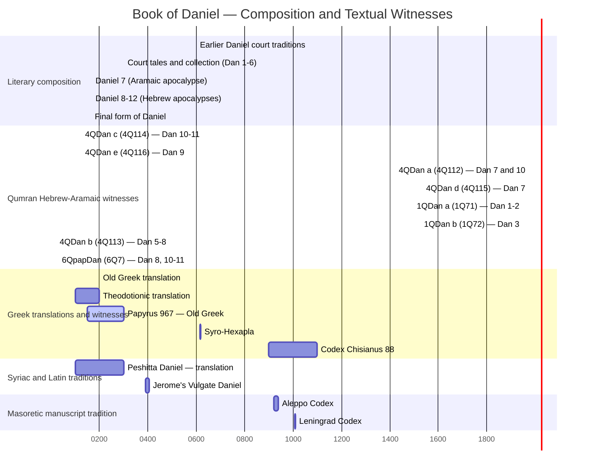

| Manuscript     | Approximate date               | Relevant chapters |
| -------------- | ------------------------------ | ----------------- |
| 1QDanᵃ (1Q71)  | 1st century BCE–1st century CE | 1–2               |
| 1QDanᵇ (1Q72)  | 1st century BCE–1st century CE | 3                 |
| 4QDanᵃ (4Q112) | Mid-1st century BCE            | 1–5, 7–8, 10–11   |
| 4QDanᵇ (4Q113) | c. 20–50 CE                    | 5–8               |
| 4QDanᶜ (4Q114) | Late 2nd century BCE           | 10–11             |
| 4QDanᵈ (4Q115) | Mid-to-late 1st century BCE    | 3–4, 7            |
| 4QDanᵉ (4Q116) | 2nd–1st century BCE            | 9                 |
| 6QpapDan (6Q7) | 1st century CE                 | 8, 10–11          |

| Witness             | Date                                                                | Language | Significance                             |
| ------------------- | ------------------------------------------------------------------- | -------- | ---------------------------------------- |
| Masoretic Text      | Medieval manuscript tradition; consonantal text substantially older | Aramaic  | Principal Hebrew Bible textual tradition |

| Tradition / witness | Estimated date                                                         | Significance                                               |     |
| ------------------- | ---------------------------------------------------------------------- | ---------------------------------------------------------- | --- |
| Old Greek Daniel    | 2nd century BCE (approx.)                                              | Earlier Greek translation, substantially different from MT |     |
| Theodotionic Daniel | 2nd century CE (traditional attribution; textual history more complex) | Eventually became the dominant Greek Daniel                |     |
| Papyrus 967         | 2nd–early 3rd century CE                                               | Important surviving Old Greek witness                      |     |
| Codex Chisianus 88  | 9th–11th century CE                                                    | Witness to the Old Greek / Hexaplaric tradition            |     |
| Syro-Hexapla        | 616–617 CE                                                             | Syriac translation of Origen's Hexaplaric Greek text       |     |
| Peshitta Daniel     | Early centuries CE; precise date uncertain                             | Syriac version based on a Hebrew-Aramaic text              |     |
| Jerome's Vulgate    | c. 390–405 CE                                                          | Latin translation based on Hebrew and Aramaic              |     |
| Aleppo Codex        | c. 930 CE                                                              | Early Masoretic codex                                      |     |
| Leningrad Codex     | 1008 CE                                                                | Oldest complete surviving Hebrew Bible codex               |     |

| Witness             | Date                                                                | Language | Significance                             |
| ------------------- | ------------------------------------------------------------------- | -------- | ---------------------------------------- |
| Jerome, Vulgate     | c. 390–405                                                          | Latin    | Latin biblical transmission              |
