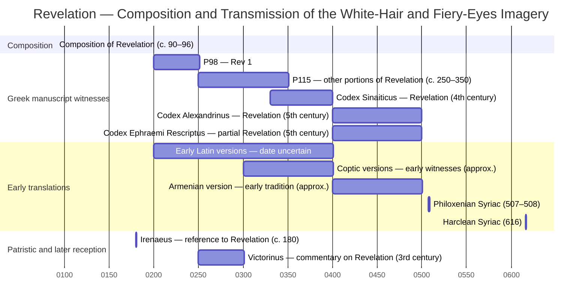

### Chronology

| Date                  | Witness or event                             | Relevance                                                                                                                                                                  |
| --------------------- | -------------------------------------------- | -------------------------------------------------------------------------------------------------------------------------------------------------------------------------- |
| c. 80–100 CE          | Composition of Revelation                    | Common scholarly range; the traditional Domitianic dating is c. 95–96.                                                                                                     |
| c. 150–250            | **P98**                                      | Earliest surviving physical witness to Rev 1:13–20, including 1:14. The exact palaeographical dating is not uniform.                                                       |
| 3rd–4th century       | P18                                          | Rev 1:4–7, not the white-hair passage. Useful as an earlier witness to the book's transmission.                                                                            |
| 3rd–4th century       | P47                                          | Preserves Rev 9:10–17:2, not the passages under examination.                                                                                                               |
| 3rd–4th century       | P115                                         | Preserves portions of Revelation, including 2:1–3, but not 2:18.                                                                                                           |
| 4th–early 5th century | **Codex Sinaiticus**                         | An important early continuous Greek witness to all three passages: 1:14, 2:18 and 19:12. Its date is less precise than the conventional mid-fourth-century label suggests. |
| 5th century           | Codex Alexandrinus                           | Another major Greek witness to Revelation.                                                                                                                                 |
| Late 3rd century      | Victorinus of Pettau                         | Earliest known commentary on Revelation; important for early interpretation.                                                                                               |
| c. 398                | Jerome's revision of Victorinus's commentary | Evidence for the Latin commentary and textual tradition.                                                                                                                   |
| Early 6th century     | Philoxenian Syriac                           | An early Syriac translation of Revelation.                                                                                                                                 |
| 615–616               | Harklean Syriac                              | Later Syriac translation.                                                                                                                                                  |

