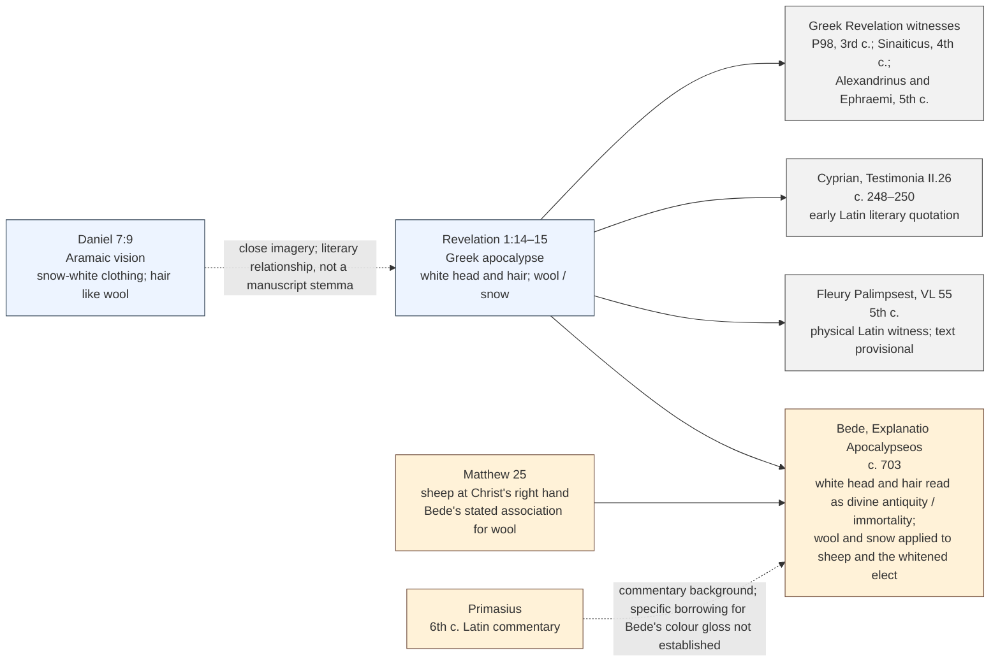
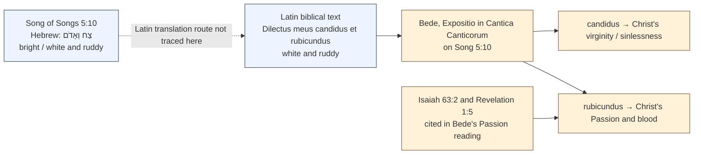
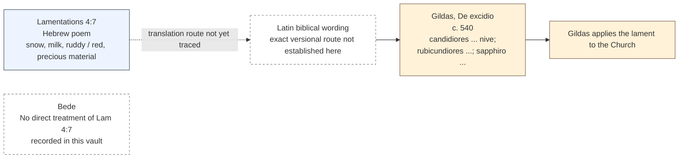

# Transmission diagrams — scriptural sources to Bede

These diagrams map the transmission and reception evidence currently recorded in this vault. They distinguish a text’s literary source, surviving textual witnesses, quotations, and later interpretation. A manuscript witness is not automatically an ancestor of another witness.

**Arrow key:** solid arrows mark a direct quotation, explicit use, or attested textual presence; dashed arrows mark a proposed literary or exegetical connection whose exact route is not established; no arrow means the vault currently records no transmission link.

## 1. Daniel 7:9 → Revelation 1:14 → Bede on Revelation

Daniel 7:9’s white clothing and wool-like hair are closely echoed in Revelation 1:14. The vault records Jerome’s explicit comparison of Daniel’s vision with John’s Apocalypse. The diagram therefore marks the Daniel-to-Revelation relationship as an intertextual echo, not as a demonstrated manuscript chain.

### Reading this diagram

- Daniel 7 and Revelation 1 share the white-head/hair and wool/snow imagery, and the vault records Jerome drawing the comparison. The diagram does not claim that a particular Daniel manuscript was copied into Revelation.
- P98, the Greek codices, Cyprian’s quotation, and Fleury are separate evidence points. Cyprian is a dated literary quotation, not a surviving copy of Revelation; Fleury is a surviving Latin manuscript, not a demonstrated copy of Cyprian.
- Bede’s commentary directly interprets Revelation 1:14. His explanation of wool invokes the sheep at the right hand; his snow imagery evokes the multitude of the elect made white. The vault records a Primasius connection for Bede’s exposition of the feet, but does not establish that Bede borrowed his white-hair interpretation from Primasius.

## 2. Song of Songs 5:10 → Bede on the Song

This is the clearest direct route from one of the project’s red-and-white passages to Bede: Bede quotes the Latin verse and interprets the colour pair allegorically.

The dashed edge marks the untraced Latin translation history; the solid edge records Bede’s quotation of the Latin wording and his own commentary. The final nodes are reception, not alternate lexical translations: Bede reads *candidus* and *rubicundus* Christologically, with the red linked to the Passion rather than to a literal complexion.

## 3. Lamentations 4:7 → Gildas; no recorded continuation to Bede

The vault records Gildas quoting Lamentations 4:7 in the sixth century and applying the lament to the Church. It does not record Bede commenting on this verse or a link from Gildas’s use to Bede.

Gildas is therefore a reception endpoint for Lamentations in the evidence assembled so far, not a proven link in Bede’s reading of Song of Songs or Revelation. The Lamentations and Song passages can be compared as Hebrew red-and-white imagery, but the vault does not establish literary dependence between them.

## Limits and next evidence to collect

- Collate the Latin biblical lemma in Bede against the Latin witnesses actually available to him; a shared wording does not identify the specific exemplar.
- Compare Bede’s Revelation exposition line-by-line with Primasius and other Latin commentators before extending a source arrow to the white-hair gloss.
- Verify the Greek and Latin textual forms and manuscript dates from the editions listed in the linked witness notes.
- Do not extend Gildas’s Lamentations quotation to Bede without evidence of Bede’s use of Gildas or the verse.

## Sources in this vault

- [[Daniel 7 - Ancient of Days]]
- [[Revelation 1 - Son of Man vision]]
- [[Cyprian - Revelation]]
- [[Fleury Palimpsest - VL 55 - Revelation]]
- [[Bede's Expositio Apocalypseos]]
- [[Song of Songs 5 - Bright and ruddy]]
- [[Lamentations 4 - Nazirites like snow]]
- [[Gildas on Lamentations]]
- [[Transmission chronology]]
