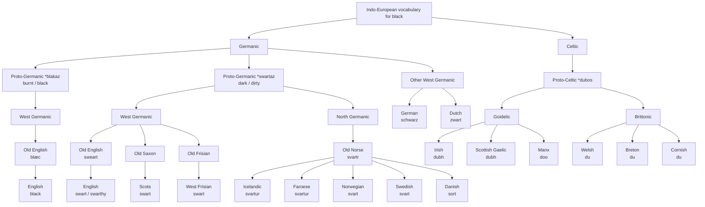
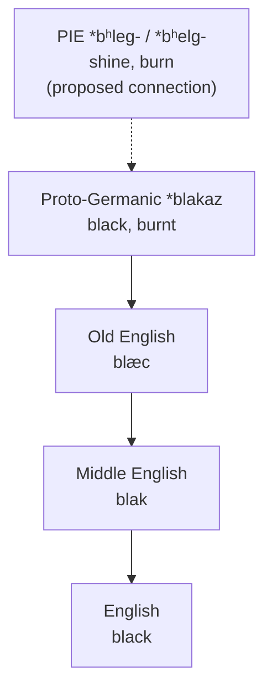
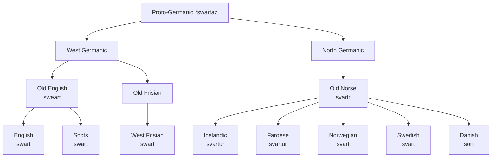
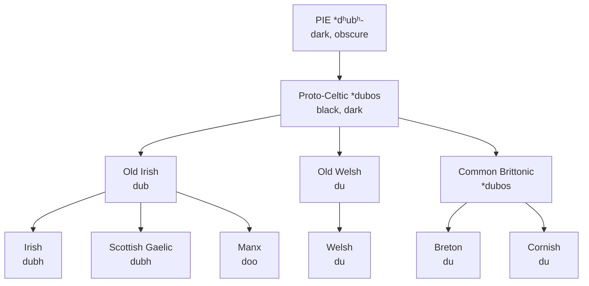

# The etymology of words for the colour *black*

## 1. The proposed PIE origin of Black

The traditional etymology connects _black_ with:

# **_*bʰleg-_**

**Proto-Indo-European (proposed)**

_To burn; to shine, gleam, flash._

Also represented in some etymological treatments as *bʰelg- or under the broader root *bʰel-.

**The proposed semantic development**

## SHINE / BURN

↓

**Burning, blazing, glowing**

↓

**Burnt, charred, blackened**

↓

**BLACK**

This is an attractive semantic explanation: a word associated originally with burning could develop into a word describing the blackened appearance of something burnt.

However, there is an important scholarly qualification.

**The Oxford English Dictionary does not regard the PIE derivation as established**. It says that the further etymology is uncertain. The difficulty is that the proposed relationship with a root meaning _shine_ or _burn brightly_ does not straightforwardly explain the meaning _black_.

The proposed connection is therefore a traditional etymological hypothesis, not an uncontested reconstruction.

### **1.1 The Indo-European family associated with the proposed root**

The root *bʰleg- has a much better-established family of words relating to burning and brightness.

|Language|Historical form|Meaning|
|---|---|---|
|Ancient Greek|φλέγω (_phlégō_)|Burn, blaze|
|Ancient Greek|φλέγειν (_phlégein_)|To burn, scorch|
|Ancient Greek|φλόξ (_phlóx_)|Flame|
|Ancient Greek|φλέγμα (_phlégma_)|Flame, inflammation; later phlegm|
|Latin|_flagrāre_|To blaze, burn|
|Latin|_flagrāns_|Burning, blazing|
|Latin|_flamma_|Flame|
|Latin|_fulgēre_|To shine, gleam|
|Latin|_fulgur_|Lightning|
|Sanskrit|_bhrāj_|To shine|
|Sanskrit|_bhárgas_|Radiance, splendour|

The Greek and Latin forms are particularly important. Compare:

- Greek _phlégō_: I burn.    
- Latin _flagrāre_: to burn or blaze.    
- English _flagrant_: originally associated with something blazing or conspicuous.    
- English _conflagration_: a great fire.    
- English _deflagration_: rapid burning.    

These belong to the wider Indo-European family traditionally reconstructed around the idea of burning and shining. The University of Texas Indo-European Lexicon records the relevant forms under Pokorny's _bheleg-_ ('to shine, glisten').

A useful distinction: these Greek, Latin and Sanskrit words are cognates of the proposed PIE root, not necessarily cognates of English _black_ in the stricter sense. The Germanic connection is the disputed part.

## **2. Proto-Germanic: the immediate ancestor of English** **_black_**

The conventional reconstruction is: Proto-Germanic *blakaz 

Meaning: _burnt, blackened_, or _black_.

This is the immediate reconstructed ancestor traditionally proposed for Old English _blæc_.

The difficulty is that the Proto-Germanic reconstruction is supported by a relatively small group of surviving forms, and the evidence does not establish the proposed PIE derivation.

### **2.1 Germanic cognates**

|Branch|Language|Form|Meaning|
|---|---|---|---|
|West Germanic|Old English|_blæc_|Black, dark|
|West Germanic|Old Saxon|_blac_|Ink|
|West Germanic|Middle Dutch|_blac_|Ink|
|West Germanic|Middle Low German|_blak_|Ink, black dye, black colour|
|West Germanic|Old High German|_blah-_|Black, ink-coloured (in compounds)|
|North Germanic|Old Norse|_blakkr_|Dark|
|North Germanic|Icelandic|_blakkr_|Black|
|North Germanic|Danish|_blak_|Black, dark|
|North Germanic|Swedish|_black_|Black, dark|

The modern Scandinavian forms deserve a qualification: their historical relationship to the Germanic _blak-_ group is not equally well documented in every case.

The most interesting West Germanic form is Dutch:

- _blaken_ — to burn, flame, scorch.    
- _blakeren_ — to scorch, blacken.    

These verbs make the traditional association with burning plausible.

However, the Oxford English Dictionary notes that the Germanic adjective could instead be related to the wider family represented by _blank_ and _bleak_, with the semantic problem that those words generally mean bright, pale or shining.

The etymological relationship remains unsettled.

## 3. The Old English history: _blæc_ and _blāc_

### **_blæc_**

Adjective; also noun in certain uses.

**Principal meanings**

- Black, dark.    
- The colour of soot or coal.    
- Ink, in related Germanic usage.
    
### _blāc_

Adjective

**Principal meanings**
   
- Bright.    
- Shining.    
- Pale, white or colourless.

Old English had two very similar-looking words:

|Form|Pronunciation (approximately)|Meaning|
|---|---|---|
|_blæc_|/blæk/|Black, dark|
|_blāc_|/blɑːk/|Shining, bright, pale|

They were not simply alternative spellings of the same adjective.

The distinction is especially important when reading medieval manuscripts, where vowel length is not always marked consistently in modern editions. The two forms also became confused in Middle English, where _blak_, _blac_ and _blake_ could refer to either darkness or paleness.

This ambiguity eventually affected the surname **Blake**, which can have either a dark-complexioned or pale-complexioned origin.

The University of Texas Indo-European Lexicon records both Old English forms in its discussion of the wider _bheleg-_ family.

#### Textual Confusion and Errors

1. **Scribal substitution:** a scribe writes _blāc_ where the context and another witness suggest _blæc_.   
2. **Editorial misreading:** an editor or transcriber interprets an ambiguous manuscript form as _blāc_ rather than _blæc_.
    
3. **Genuine lexical ambiguity:** the manuscript really does contain a form whose spelling does not allow us to establish the intended vowel confidently.

Filip Missuno's 2012 University of York PhD thesis, [_‘Shadow’ and Paradoxes of Darkness in Old English and Old Norse Poetic Language_](https://etheses.whiterose.ac.uk/id/eprint/3158/1/Shadow_-_PhD_thesis_-_FM_-_2012.pdf). Missuno discusses precisely this problem in §2.2.5, entitled _Blæc/blāc_ (pp. 84–91). His observation is quite explicit:

- The two words are difficult to distinguish in manuscripts.
- Scribal variants suggest that the confusion was not merely a modern editorial problem.
- Metre can sometimes distinguish them, but context is less reliable.
- The _Dictionary of Old English_ itself warns that context does not always establish which word is intended.

Missuno identifies two particularly important forms:

|Form|Intended word|Grammatical form|
|---|---|---|
|_blacne_|_blæc_|Accusative singular|
|_blācne_|_blāc_|Accusative singular|
|_blacum_|_blæc_|Dative plural|
|_blācum_|_blāc_|Dative plural|

These are precisely the forms in which the vowel distinction can become visible in an edited text. Missuno refers readers to the variant readings recorded in the DOE entries for both words (his footnote 101, p. 87)

## Juxtaposition 
### In Bede's _Historia ecclesiastica_, translated into Old English.

The passage reads:

> He hæfde blæc feax, and blácne andwlitan.

Translation:

> He had black hair and a pale countenance.

The Latin is:

> _nigro capillo, facie macilenta._

Here the distinction is unambiguous:

- _blæc feax_ — black hair.
    
- _blácne andwlitan_ — pale face.

### In *Judit*

In the Old English poem _Judith_, we find:

> Blácne

Accusative singular, meaning _pale_.

Bosworth–Toller cites:

- _Judith_, line 12.    
- _Judith_, line 278.

These are useful because they establish that _blāc_ could describe pallor, rather than simply brightness or luminosity.

## **4. The wider Germanic vocabulary for black**

It is important not to assume that all Germanic words for black descend from _blakaz_.

In fact, another much more widespread Germanic word family is descended from a different PIE root, traditionally reconstructed as _sword-_, meaning approximately _dark, dirty_.

This is the family that supplied the usual word for black in several Germanic languages.

### **4.1 The** **_swart-_** **family**

|Language|Historical form|Modern form|Meaning|
|---|---|---|---|
|Gothic|_swarts_|—|Black|
|Old English|_sweart_|_swart_|Dark, black, swarthy|
|Old High German|_swarz_|—|Black|
|Middle High German|_swarz_|—|Black|
|German|—|_schwarz_|Black|
|Old Saxon|_swart_|—|Black|
|Dutch|_zwart_|_zwart_|Black|
|Old Frisian|_swart_|_swart_|Black|
|Old Norse|_svartr_|—|Black|
|Icelandic|_svartr_|_svartur_|Black|
|Faroese|_svartur_|_svartur_|Black|
|Danish|_sort_|_sort_|Black|
|Norwegian|_svart_|_svart_|Black|
|Swedish|_svart_|_svart_|Black|
|Yiddish|_shvarts_|_שוואַרץ_|Black|
|Afrikaans|—|_swart_|Black|

This is a remarkably widespread family.

Notice the distinction between:

- English _black_, from the relatively restricted _blak-_ family.    
- English _swart_, from the much more widespread _swart-_ family.
    

Old English _sweart_ was actually the usual word for black before _blæc_ became dominant.

The German _schwarz_, Dutch _zwart_, and Scandinavian _svart_ words belong to the latter family, not to the ancestry of English _black_.

## **5. Other Indo-European branches: how they express black**

This is where the comparison becomes especially interesting.

There is no single PIE word for black that has simply survived across all Indo-European languages. Instead, the modern languages preserve several different ancient roots, often based on darkness, dirt, obscurity or burning.

The following is a comparative survey based particularly on Carlotta Viti's substantial study, _Semantic Variation and Semantic Change in the Color Lexicon_ (2025), which examines colour terminology in 70 ancient and modern Indo-European languages.

### **5.1 Italic and Romance**

The principal Latin words were _niger_ and _āter_.

|Language|Word|Meaning|
|---|---|---|
|Latin|_niger_|Black, dark|
|Latin|_āter_|Dull black, dark, gloomy|
|Umbrian|_atru_|Black|
|Italian|_nero_|Black|
|Spanish|_negro_|Black|
|Catalan|_negre_|Black|
|French|_noir_|Black|
|Occitan|_negre_|Black|
|Romansh|_nair_|Black|
|Romanian|_negru_|Black|
|Sardinian|_nigheddu_|Black|
|Portuguese|_preto_|Black|

There are two particularly interesting developments here.

**Latin** **_niger_**

This is the ancestor of the principal black word in most Romance languages:

$\textit{niger} \rightarrow \begin{cases} \text{Italian nero}\\ \text{Spanish negro}\\ \text{French noir}\\ \text{Romanian negru} \end{cases}$ \]$

The ultimate etymology of Latin _niger_ is uncertain.

**Latin** **_āter_**

This is a different word, generally associated with dark, dull or gloomy blackness.

Viti associates it with PIE _h₂eh₁-_ 'burn'.

This distinction in Latin is useful because _niger_ and _āter_ could convey different qualities of darkness rather than merely functioning as interchangeable colour labels.

Portuguese _preto_ has a quite different history, probably deriving from a Vulgar Latin expression associated with pressing against the breast, with a semantic development involving thickness and darkness.

De Gruyter Brill+1

### **5.2 Greek**

|Period|Form|Meaning|
|---|---|---|
|Ancient Greek|μέλας (_mélas_)|Black, dark|
|Ancient Greek|μέλαινα (_mélaina_)|Black (feminine)|
|Ancient Greek|μέλαν (_mélan_)|Black (neuter)|
|Modern Greek|μαύρος (_mávros_)|Black|

The Ancient Greek word _mélas_ is particularly important.

Its reconstructed PIE origin is:

\*h_2melh_2- 

Meaning approximately _dark, dirty_.

The same root is associated with darkness and dirtiness in other Indo-European languages.

Modern Greek _mávros_ has a different history, deriving from Ancient Greek _maurós_, meaning dark.

This is an example of a language replacing an older colour term with another word from its own vocabulary.

### **5.3 Celtic**

|Language|Form|Meaning|
|---|---|---|
|Old Irish|_dub_|Black|
|Modern Irish|_dubh_|Black|
|Scottish Gaelic|_dubh_|Black|
|Welsh|_du_|Black|
|Breton|_du_|Black|

The reconstructed PIE root is:

 *d^h u b^h- 

Meaning approximately _dark, obscure_.

The Celtic forms are especially interesting because the same word family has remained remarkably stable across several millennia.

Compare:

- Old Irish _dub_.    
- Modern Irish _dubh_.    
- Welsh _du_.    
- Breton _du_.    

The modern Welsh and Breton forms are strikingly similar.

### **5.4 Baltic**

|Language|Form|Meaning|
|---|---|---|
|Old Prussian|_kirsnan_|Black|
|Lithuanian|_júodas_|Black|
|Latvian|_mȩl̃ns_|Black|

The Old Prussian form belongs to the PIE root:

 *kers- 

Meaning _black, dark_.

Latvian _mȩl̃ns_ is associated with:

 *melh_2- 

Meaning _dark, dirty_.

The etymology of Lithuanian _júodas_ is uncertain.

### **5.5 Slavic**

The Slavic languages preserve another very widespread ancient root.

|Language|Form|Meaning|
|---|---|---|
|Old Church Slavonic|_črŭnŭ_|Black|
|Russian|_čërnyj_ (чёрный)|Black|
|Ukrainian|_čórnyj_ (чорний)|Black|
|Polish|_czarny_|Black|
|Czech|_černý_|Black|
|Slovak|_čierny_|Black|
|Slovenian|_črn_|Black|
|Croatian|_crn_|Black|
|Serbian|_crn_ (црн)|Black|
|Bulgarian|_čéren_ (черен)|Black|
|Macedonian|_crn_|Black|

The reconstructed PIE root is:

 *kers- 

Meaning _dark, obscure_.

This is the same root associated with Old Prussian _kirsnan_.

The relationship between these forms is particularly interesting because it shows how a single prehistoric root can produce markedly different-looking words through the sound changes of different branches.

### **5.6 Indo-Iranian**

The Indo-Iranian languages provide several distinct ancient colour roots.

**Iranian**

|Language|Form|Meaning|
|---|---|---|
|Avestan|_siiāuua-_|Black, dark|
|Sogdian|_š’w / šw_|Black|
|Persian|_siyāh_ (سیاه)|Black|
|Dari|_siyāh_|Black|
|Tajik|_siyoh_|Black|
|Pashto|_tūr_|Black, dark|

The Iranian _siyāh_ family is associated with PIE:

 *ḱi(H)- 

Meaning _dark, obscure_.

Pashto _tūr_ has a different ancestry, associated with PIE _temH-_ 'dark'.

**Indic**

|Language|Form|Meaning|
|---|---|---|
|Vedic Sanskrit|_kṛṣṇá-_|Black, dark|
|Classical Sanskrit|_kṛṣṇa-_|Black, dark|
|Hindi|_kālā_|Black|
|Bengali|_kālō_|Black|
|Gujarati|_kāḷo_|Black|
|Marathi|_kāḷā_|Black|
|Punjabi|_kālā_|Black|
|Nepali|_kālo_|Black|
|Konkani|_kāḷo_|Black|
|Sindhi|_kāru_|Black|
|Sinhala|_kaḷu_|Black|
|Dhivehi|_kalhu_|Black|

Sanskrit _kṛṣṇa-_ is associated with PIE:

 *kers- 

Meaning _black, dark, dirty_.

The modern Indic _kālā_ family has a more complicated history: Viti traces it to Old Indic _kāla-_ and ultimately to a Dravidian source, rather than treating it as a straightforward inherited PIE word.

That is an important reminder that the vocabulary of Indo-European languages also includes borrowings from neighbouring language families.

### **5.7 Armenian**

|Period|Form|Meaning|
|---|---|---|
|Classical Armenian|_seaw_|Black|
|Modern Eastern Armenian|_sev_ (սև)|Black|

The Classical Armenian form is generally understood as an Iranian borrowing.

It is therefore not an independent, direct continuation of the relevant PIE colour root.

### **5.8 Tocharian**

The extinct Tocharian languages are particularly valuable because they preserve an ancient Indo-European branch in Central Asia.

|Language|Form|Meaning|
|---|---|---|
|Tocharian B|_kwele_|Black, dark|
|Tocharian B|_erkent-_|Black, dark|

The first is associated with PIE _ḱi(H)-_ 'dark, obscure'.

The second is associated with PIE _h₁regʷ-_ 'dark, obscure'.

These are independent etymological developments.

### **5.9 Anatolian: Hittite**

Hittite is especially important because it represents one of the earliest-diverging Indo-European branches.

|Language|Form|Meaning|
|---|---|---|
|Hittite|_dankui-_|Dark, black|
|Hittite|_ḫanzana-_|Dark, black|

The first is cognate with German _dunkel_ (dark), and is associated with a PIE root meaning darkness.

The second is derived from:

*h_2m̥s-

Meaning _dark, black_.

### **5.10 Albanian**

|Language|Form|Meaning|
|---|---|---|
|Albanian|_zi_|Black|

This is derived from a PIE root:

\[ *g^w ed^h- \]

Meaning _dirty_.

The semantic development from _dirty_ to _black_ is another example of how colour vocabulary can emerge from descriptions of the physical properties of objects.

## **6. Comparative table of PIE roots for black**

The following table brings together the different roots discussed above.

|PIE reconstruction|Approximate meaning|Principal descendants|
|---|---|---|
|*bʰelg- / *bʰleg-|Shine, burn|Proposed Germanic _black_ connection|
|*sword-|Dark, dirty|Germanic _swart_, _schwarz_, _svart_|
|*ḱi(H)-|Dark, obscure|Persian _siyāh_, Tocharian B _kwele_|
|*temH-|Dark|Pashto _tūr_|
|*kers-|Black, dark, dirty|Sanskrit _kṛṣṇa-_, Slavic _černy_, Old Prussian _kirsnan_|
|*melh₂-|Dark, dirty|Greek _mélas_, Latvian _mȩl̃ns_|
|*dʰubʰ-|Dark, obscure|Irish _dubh_, Welsh _du_, Breton _du_|
|*h₂eh₁-|Burn|Latin _āter_|
|*h₂m̥s-|Dark, black|Hittite _ḫanzana-_|
|*gʷedʰ-|Dirty|Albanian _zi_|
|*h₁regʷ-|Dark, obscure|Tocharian B _erkent-_|

**An important qualification:** these are not all equally certain reconstructions, and the table represents the proposed etymologies of individual colour words, not a single PIE system of colour terminology.

The comparative evidence is drawn principally from Viti's analysis of 70 Indo-European languages.

De Gruyter Brill+1

## 7. _Black_, _white_, _bleak_, _blank_ and _bleach_

I think this is particularly worth examining alongside your earlier investigation of _white_.

There is a striking historical relationship between words that now express opposite colours.

Consider the following English words:

|Word|Meaning|Historical association|
|---|---|---|
|Black|Dark, absorbing light|Germanic _blak-_|
|Bleak|Pale, colourless; exposed, desolate|Brightness/paleness|
|Blank|Empty, unmarked; originally white|Brightness/whiteness|
|Bleach|Remove colour, whiten|Brightness/whiteness|
|Blanch|Make white or pale|Brightness/whiteness|
|Blink|Twinkle, flash|Light|
|Flame|Burning light|Burning|
|Flagrant|Blazing, conspicuous|Burning|

The wider _bʰelg- / bʰleg-_ family has traditionally been used to explain some of these relationships.

There is an intriguing possibility that the original semantic field was not organised around colour oppositions at all, but around physical processes:

- Shining.    
- Glowing.    
- Burning.    
- Scorching.    
- Charring.    
- Becoming pale.    
- Losing colour.    

These processes could generate apparently contradictory colour meanings.

The distinction between Old English _blæc_ and _blāc_ is an especially good example.

However, I would resist treating every word in this list as a proven descendant of precisely the same PIE formation. The OED's caution about the etymology of _black_ is important here.

## **8. What the comparative evidence tells us about prehistoric colour terminology**

There is a broader linguistic observation worth making.

The Indo-European languages do not appear to have inherited one uniform, universally preserved word for black.

Instead, we find several different semantic starting points:

**1. Darkness and obscurity**

_ḱi(H)-_, _temH-_, _sword-_

Darkness, lack of light, obscurity.

**2. Dirt and physical contamination**

_kers-_, _melh₂-_, _gʷedʰ-_

Dirty, stained, darkened.

**3. Burning and charring**

_bʰleg-_ (proposed for English _black_), _h₂eh₁-_

Burning, scorching, blackening.

**4. Physical appearance**

_dʰubʰ-_, _h₂m̥s-_

Dark, obscure, black.

This is significant for historical semantics.

A colour word can originate in a description of a physical process or property, rather than in an abstract colour category.

The same applies to _white_: its Indo-European vocabulary frequently develops from ideas of shining, brightness, clearness and visibility.

Carlotta Viti's research is particularly useful here because it examines the semantic development of colour terminology across a large number of ancient and modern Indo-European languages, rather than simply compiling cognate lists.

## **9. Recommended scholarly references**

Prioritise the following sources.

1. **Oxford English Dictionary**, _black, adj. & n._ — the most important reference for the English word. Particularly useful because it explicitly identifies the uncertainty surrounding its deeper etymology. [OED entry: black](https://doi.org/10.1093/OED/1350335278?utm_source=chatgpt.com).

2. **Carlotta Viti** **(2025), "Semantic Variation and Semantic Change in the Color Lexicon",** **_Linguistics_****, 63(4), 949–1027.** — exceptionally useful for comparing colour terminology across 70 Indo-European languages. [Read the article](https://www.degruyterbrill.com/document/doi/10.1515/ling-2023-0161/html?utm_source=chatgpt.com).

3. **University of Texas Indo-European Lexicon**, Pokorny etymon _bheleg-_ — useful for examining the wider family of words associated with shining and burning. [PIE etymon and reflexes](https://lrc.la.utexas.edu/lex/master/0222?utm_source=chatgpt.com).

4. **Indo-European Cognate Relationships**, Cognate Set 1343 — particularly valuable because it explicitly records the uncertainty of the further connection of Proto-Germanic _blaka-_. [IE-CoR: black](https://iecor.clld.org/cognatesets/1343?utm_source=chatgpt.com).

5. **Pokorny's Indogermanisches etymologisches Wörterbuch** — a major historical reference for the reconstructed Indo-European roots. Its reconstructions should be considered alongside more recent work, rather than treated as definitive in every case.

## **10. Conclusion**

The most important finding is that **English** **_black_** **is not securely traceable to PIE**, despite the traditional and plausible connection with _bʰleg-_ ('burn, shine').

The secure part of the history is:

# **_black_**

## Modern English

↓

## **_blak_**

Middle English

↓

## **_blæc_**

Old English

↓

## **_*blakaz_**

Proto-Germanic (reconstructed)

↓

## **_*bʰleg- / *bʰelg-_**

Proposed, not established

Proto-Indo-European

For your historical colour vocabulary research, I would retain three separate entries in your notes:

- **BLACK —** **_blakaz_**: the Germanic history of English _black_.
    
- **DARK —** **_sword-_****,** **_ḱi(H)-_****,** **_temH-_****, etc.**: the various Indo-European roots associated with darkness.
    
- **BURN / SHINE —** **_bʰleg-_**: the proposed deeper connection between blackness, burning and brightness.
    

That separation will help avoid conflating cognacy with semantic association, which is particularly important when tracing the historical language of physical appearance, complexion and hair colour.