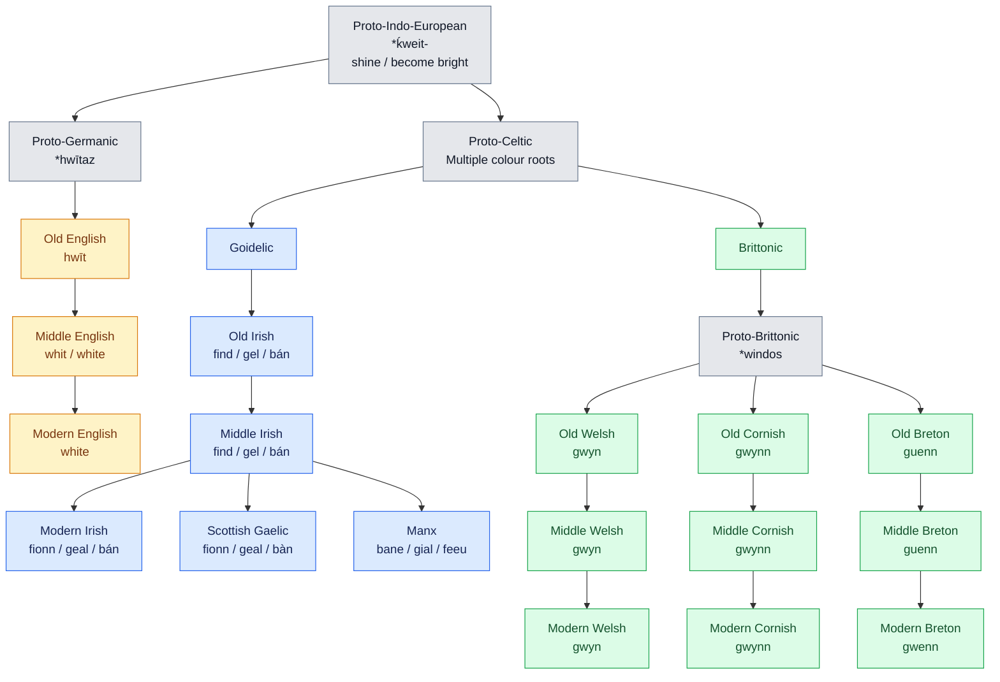

# **The etymology of** **_white_****: from Proto-Indo-European to the modern languages**

## **1. Proto-Indo-European: the root *ḱweit-**

# ***ḱweit-**

Reconstructed PIE root

**Core meanings:** to shine; to become bright; to be luminous; to be white.

Traditional root notation: *ḱwei-t-; also represented in dictionaries as an extended root of *ḱwei-.

The root is recorded in Julius Pokorny's _Indogermanisches etymologisches Wörterbuch_ under:

**3.** **_ḱuei-_****, with extensions** **_ḱuei-d-_****,** **_ḱuei-s-_** **and** **_ḱuei-t-_****.**

Its semantic field is given as:

- To shine.
    
- To glisten.
    
- To be bright.
    
- To be white.
    

The University of Texas Indo-European Lexicon preserves this classification and provides a useful collection of the historical reflexes.

### **The reconstructed forms**

There are several related forms worth distinguishing:

|Reconstruction|Significance|
|---|---|
|*ḱwei-|Basic root associated with shining|
|*ḱweit-|Root extended with _-t-_|
|*ḱweit-o-|Adjectival formation associated with brightness or whiteness|
|*ḱwit-no-|Formation with _-no-_, particularly relevant to Sanskrit and Germanic|

The precise derivational relationship between these formations is not entirely settled.

A particularly important distinction is between the two Sanskrit adjectives:

- **śvetá-** — white, bright.
    
- **śvítna-** — whitish, white, light-coloured.
    

They represent different formations associated with the same underlying root.

Kroonen's _Etymological Dictionary of Proto-Germanic_ (2013, p. 267) reconstructs Germanic *hwīta- ~ *kwitta- and compares it with PIE *ḱu(e)it-nó-, including Sanskrit śvítna-. Mayrhofer's Sanskrit etymological dictionary discusses the related *ḱwei-tó- formation behind śvetá-.

Cognate Set 338

## **2. The Germanic branch: the direct ancestry of English** **_white_**

This is the branch most important for the history of the English word.

The reconstructed Proto-Germanic adjective is:

*******hwītaz — white, bright, shining.**

The reconstruction is supported by forms across all three major Germanic subdivisions.

### **2.1 East Germanic**

|Language|Form|Meaning|
|---|---|---|
|Gothic|ƕeits|White|
|Crimean Gothic|_wichtgata_ (reported form)|White|

Gothic is especially valuable because it provides an early, independent attestation of the Germanic adjective.

The Gothic letter ƕ represents a voiceless labiovelar fricative, conventionally transliterated _hw_.

### **2.2 West Germanic**

|Language|Historical form|Modern descendant|
|---|---|---|
|Old English|hwīt|English white|
|Old Frisian|hwīt|Frisian wyt|
|Old Saxon|hwīt|—|
|Old High German|(h)wīz|German weiß|
|Middle Dutch|wit|Dutch wit|
|Old Dutch|—|—|
|Yiddish|—|vays|
|—|—|Afrikaans wit|

Some additional modern descendants:

- Luxembourgish: wäiss.
    
- Scots: white.
    
- West Frisian: wyt.
    
- Low German: witt / wit, depending on dialect.
    

The important historical forms are Old English _hwīt_, Old Saxon _hwīt_, Old Frisian _hwīt_, Old High German _(h)wīz_ and Gothic _ƕeits_.

The English spelling preserves the original _hw_ sequence, although the pronunciation of standard English has changed.

### **2.3 North Germanic**

|Language|Historical form|Modern form|
|---|---|---|
|Old Norse|hvítr|—|
|Icelandic|hvítr|hvítur|
|Faroese|hvítr|hvítur|
|Danish|—|hvid|
|Norwegian|—|hvit|
|Swedish|—|vit|

The Old Norse adjective _hvítr_ is particularly interesting because its semantic range includes both white and shining.

That association is not merely a reconstructed PIE possibility: it is visible in the Germanic historical vocabulary itself.

### **2.4 The Proto-Germanic development**

The simplified lineage is:

**PIE ḱweit-**

Shine; be bright; be white

**Proto-Germanic hwītaz**

White; bright; shining

**West Germanic**

OE hwīt

OHG (h)wīz

Dutch wit

**North Germanic**

ON hvítr

Danish hvid

Swedish vit

**East**

Gothic ƕeits

# **Modern English white**

The Germanic forms are generally connected with PIE *ḱwit- 'shine'. However, the exact phonological and morphological reconstruction has been debated.

In particular, Kroonen reconstructs a relationship involving *hwīta- and *kwitta-, with the latter reflecting a possible geminate consonant development. The explanation involves Germanic consonant morphology and the proposed operation of Kluge's Law.

It is therefore better not to present the entire Germanic sound history as a simple, mechanically regular conversion of *ḱ to *hw.

Sources: Kroonen, _Etymological Dictionary of Proto-Germanic_ (2013), p. 267; Kluge, _Etymologisches Wörterbuch der deutschen Sprache_; Viti (2025).

## **3. Indo-Iranian: Sanskrit and the Iranian languages**

This is arguably the most important comparison outside Germanic.

The Indo-Iranian languages preserve a particularly rich collection of words associated with the PIE root.

### **3.1 Vedic Sanskrit**

# **श्वेत — śvetá-**

Direct cognate

**Meaning:** white, bright, shining, brilliant.

The Sanskrit adjective _śvetá-_ is a close comparative counterpart of Germanic _hwītaz_.

It is attested in Vedic Sanskrit, and survives into Classical Sanskrit.

Its meanings include:

- White.
- Bright.    
- Luminous.    
- Shining.    

This is important because it shows that the ancient Indo-European semantic association between whiteness and luminosity was retained in both Germanic and Indo-Aryan.

A second important formation is:

**śvítna- — whitish, white, light-coloured.**

And another:

**śvitrá- — white, whitish.**

These forms are particularly relevant because the suffixes differ from those in _śvetá-_.

The semantic relationship between the forms is strong, but they should not all be treated as the same inherited adjective.

### **3.2 Iranian**

The Iranian branch offers an especially extensive series.

|Language|Form|Meaning|
|---|---|---|
|Avestan|spaēta-|White, bright|
|Old Persian|_saita-_ (reconstructed)|White|
|Sogdian|'sp'yt|White|
|Middle Persian|spēd / spēt|White|
|New Persian|sefīd / sefid|White|
|Dari|sefīd|White|
|Tajik|safed|White|
|Pashto|spīn|White|

The Avestan adjective _spaēta-_ is particularly important.

It means both white and bright, and belongs to the same inherited Indo-Iranian family as Sanskrit _śvetá-_.

New Persian _sefīd_ is a direct historical continuation through Iranian linguistic stages, rather than a borrowing from Sanskrit.

This gives us two parallel developments:

**Indo-Aryan**

- PIE *ḱwit-    
- Vedic Sanskrit śvetá-    
- Classical Sanskrit śvetá-    
- Modern descendants and related formations

**Iranian**

- PIE *ḱwit-
    
- Avestan spaēta-
    
- Middle Persian spēd
    
- New Persian sefīd
    
- Dari sefīd / Tajik safed
    

### **3.3 Modern Indic languages: inheritance and borrowing**

The modern Indic situation is particularly interesting because not every word that resembles the ancient Sanskrit form is directly inherited.

|Language|Word|Meaning|Historical explanation|
|---|---|---|---|
|Punjabi|ciṭṭā|White|From Old Indic śvitrá-|
|Nepali|seto|White|From Old Indic śvaitra-|
|Hindi|safed|White|Iranian borrowing|
|Gujarati|safed|White|Iranian borrowing|
|Kashmiri|saphed|White|Iranian borrowing|

This is an excellent example of the difference between genetic inheritance and lexical borrowing.

Hindi _safed_ and Punjabi _ciṭṭā_ both mean white, but their historical paths are different.

The former comes through Persian/Iranian; the latter continues an Indo-Aryan formation associated with the ancient PIE root.

Viti (2025) discusses these relationships in detail, particularly the spread of Iranian _sefīd_ into neighbouring Indic languages.

De Gruyter Brill+1

## **4. Baltic: Lithuanian and Latvian**

The Baltic languages are particularly interesting because they preserve vocabulary associated with the _shining_ element of the PIE root.

However, an important distinction is necessary: the modern Baltic words for _white_ are not necessarily direct descendants of the same PIE formation as English _white_.

### **4.1 Lithuanian**

Relevant forms include:

|Lithuanian|Meaning|
|---|---|
|šviesti|To shine, illuminate|
|šviesa|Light|
|šviesus|Bright, light-coloured|
|švytėti|To shine, gleam, shimmer|
|švinta|It becomes light / dawns|

These forms are associated with the ancient _ḱweit-_ root family.

The modern Lithuanian adjective for white is:

**baltas — white.**

This belongs to a different PIE root, discussed below.

### **4.2 Latvian**

Latvian similarly preserves:

- _svīst_ / related dialectal formations: associated with shining or becoming bright.
    
- _balts_ — white.
    

The precise historical relationships among the Baltic forms require care, particularly because several similar-looking roots have become entangled through sound changes and analogy.

### **4.3 The important distinction**

|PIE root|Baltic development|Meaning|
|---|---|---|
|*ḱweit-|Lithuanian šviesti and related forms|Shine, become bright|
|*bʰelH-|Lithuanian baltas; Latvian balts|White|

The Baltic evidence therefore supports the ancient relationship between whiteness and luminosity, but does not mean that Lithuanian _baltas_ is a direct cognate of English _white_.

## **5. Slavic: an important semantic connection**

The Slavic languages have an especially interesting history because they preserve a word associated with light and brightness which is related to the same PIE root family.

### **5.1 The** **_svět-_** **family**

Old Church Slavonic:

**světŭ — light, illumination.**

Related forms include:

|Language|Word|Meaning|
|---|---|---|
|Old Church Slavonic|světŭ|Light|
|Russian|свет|Light; world|
|Ukrainian|світ|World; light|
|Polish|świat|World|
|Czech|svět|World|
|Slovak|svet|World|
|Slovene|svet|World|
|Croatian|svijet|World|
|Serbian|svet|World|

The semantic development from _light_ to _world_ is particularly noteworthy.

The world is, in a sense, the illuminated realm: the realm of visible existence.

The historical Slavic verb _světiti_ is also associated with shining and illuminating.

### **5.2 The Slavic word for white**

The modern Slavic words for white are generally derived from another PIE root:

*******bʰelH- — to shine, be bright.**

|Language|Word|Meaning|
|---|---|---|
|Old Church Slavonic|bělŭ|White|
|Russian|bélyj|White|
|Ukrainian|bilyy|White|
|Polish|biały|White|
|Czech|bílý|White|
|Slovak|biely|White|
|Slovene|bel|White|
|Bulgarian|bjal|White|
|Macedonian|bel|White|
|Serbian|beo / bijel|White|
|Croatian|bijel|White|

This distinction is worth preserving in your research:

- Slavic _svět-_ is associated with the PIE _ḱweit-_ family.    
- Slavic _běl-_ belongs to a separate PIE root _bʰelH-_.
    
Both families are associated with brightness, but they are not simply two phonological versions of the same word.

## **6. Celtic: Irish, Welsh and Breton**

The Celtic languages offer an interesting contrast. Their principal words for white do not appear to be direct descendants of _ḱweit-_.
### **6.1 Goidelic**

Old Irish has several important words for white:

|Old Irish|Meaning|Modern descendant|
|---|---|---|
|bán|White, pale|Irish bán|
|find / finn|White, fair|Irish find|
|gel|Bright, white, pale|Irish geal|
Of these, _bán_ is especially interesting.

It is associated with PIE:

\*bʰeh₂- — to shine.

This is a different root from _ḱweit-_.

The word _find_ belongs to Proto-Celtic _windo-_ and is possibly related to PIE _weyd-_ — to see.

_Gel_ has a separate history associated with PIE _ǵʰelh₃-_ — yellow-green.

Thus the Irish colour vocabulary incorporates several different ancient conceptual associations:

- Brightness.    
- Visibility.    
- Yellow-green colour.
    
### **6.2 Brittonic**

|Language|Word|Meaning|
|---|---|---|
|Welsh|gwyn|White, fair, blessed|
|Breton|gwenn|White|
|Cornish|gwynn|White|
Welsh _gwyn_ and Breton _gwenn_ belong to the Proto-Celtic _windo-_ family.

**They are not direct cognates of English _white_.**

Nevertheless, their semantic associations with fairness, purity and brightness are important for the cultural history of whiteness.

## **7. Italic and Romance: a particularly useful comparison**

The Romance languages generally do not retain a descendant of PIE _ḱweit-_ as their ordinary word for white. Latin had several different words for whiteness.

### **7.1 Latin** **_albus_**

**albus — white, pale, colourless.**

This is the ancestor of:

|Language|Word|Meaning|
|---|---|---|
|Latin|albus|White|
|Romanian|alb|White|
|Romansh|alv / alf|White|
|Italian|—|—|
|Spanish|—|—|
|Portuguese|—|—|
|French|—|—|

The word _albus_ is associated with PIE _h₂elbʰ-_ / _albʰ-_ formations, traditionally connected with brightness.

It is unrelated to English _white_.

### **7.2 Latin** **_candidus_**

**candidus — shining white, bright, brilliant, gleaming.**

This word is particularly significant.

It is associated with PIE _(s)kend-_ — to burn or shine.

It has a more explicitly luminous quality than _albus_ in many contexts.

Consider the semantic distinction:

- _albus_: white, pale.    
- _candidus_: brilliant, shining white.
    

This is not an absolute distinction in Latin usage, but it is a useful generalisation.

The Latin _candidus_ also gives us:

- Candidate.    
- Candid.    
- Candida.
    
The connection with _candidate_ comes from the Roman _toga candida_, the specially whitened toga worn by candidates for public office.

### **7.3 Germanic borrowing into Romance**

A rather surprising development is that many Romance languages have replaced their inherited Latin vocabulary for white with Germanic-derived words.

|Language|Word|Historical source|
|---|---|---|
|Italian|bianco|Germanic _blank_|
|Spanish|blanco|Germanic _blank_|
|Catalan|blanc|Germanic _blank_|
|Portuguese|branco|Germanic _blank_|
|French|blanc|Germanic _blank_|
|Occitan|blanc|Germanic _blank_|
|Sardinian|biánku|Germanic _blank_|

These words are related to Germanic vocabulary meaning shining, bright or white, but they are not descendants of English _white_.

They represent a separate Germanic borrowing into Romance.

The contrast between Latin _albus_ and the later Germanic-derived _blanc_ vocabulary is a good example of lexical replacement.

## **8. Albanian**

Albanian:

**bardhë — white.**

This word is associated with PIE:

*******bʰreh₁ǵ- — to shine, be bright.**

It is another example of an Indo-European language retaining a word for white from a root unrelated to _ḱweit-_.

The semantic connection is nevertheless familiar: whiteness as brightness.

## **9. Armenian**

Classical Armenian:

**spitak — white.**

Modern Eastern Armenian:

**սպիտակ — spitak.**

This word is particularly interesting because it is not an independent direct Armenian inheritance of the PIE root.

It is considered an Iranian borrowing, ultimately belonging to the _ḱweit-_ family.

Thus we have a linguistic pathway:

PIE _ḱweit-_ → Iranian _spaēta-_ family → Armenian _spitak_.

This is a useful reminder that the geographical distribution of a PIE root is not always identical to the distribution of its inherited descendants.

## **10. Tocharian**

Tocharian B has:

**ārkwi — white.**

This is associated with PIE _h₂r̥ǵ-_ — to shine, be bright.

It is therefore not a direct cognate of English _white_.

It belongs to another ancient Indo-European brightness root.

Tocharian is particularly valuable because it represents one of the earliest-diverging Indo-European branches, providing an important comparative perspective.

## **11. Anatolian: Hittite**

Hittite provides an interesting example of another ancient Indo-European root being used for white.

**ḫarki- — white, bright.**

It is associated with PIE:

*******h₂erǵ- /** *******h₂r̥ǵ- — to shine, be bright.**

This root is also relevant to the history of Sanskrit _árjuna-_.

The Hittite evidence is particularly valuable because Anatolian represents the earliest-diverging major branch of Indo-European.

It demonstrates that the association between whiteness and brightness was not confined to the later European and Indo-Iranian language groups.

## **12. Other Indo-Aryan languages: the wider vocabulary**

The modern Indo-Aryan languages have a much richer vocabulary for white than a single dictionary equivalent might suggest.

Here are some additional forms, including words that do not descend from _ḱweit-_.

|Language|Word|Meaning / origin|
|---|---|---|
|Sanskrit|śvetá-|White, bright; PIE _ḱweit-_|
|Sanskrit|śvitrá-|Whitish, white; PIE _ḱweit-_|
|Sanskrit|árjuna-|White, bright; PIE _h₂r̥ǵ-_|
|Hindi|safed|White; Iranian borrowing|
|Punjabi|ciṭṭā|White; Old Indic _śvitrá-_|
|Nepali|seto|White; Old Indic _śvaitra-_|
|Marathi|pāṇḍhrā|White; Old Indic _pāṇḍara-_|
|Sindhi|accho|White, clear; Old Indic _accha-_|
|Sinhala|sudu|White; from _śuddha-_|
|Dhivehi|hudhu|White; related to _śuddha-_|
|Bengali|śādā|White; historically associated with Persian borrowing|
|Gujarati|safed|White; Iranian borrowing|
|Kashmiri|saphed|White; Iranian borrowing|

This is an especially interesting set for historical semantic research because the vocabulary of whiteness derives from several different concepts:

- Shining.    
- Being bright.    
- Being clear.    
- Being clean or purified.    
- Being pale.    
- Being free of shadow.

We should build up examples in the Insular languages for the above, as well as Old and later Latin and Greeks, Aramaic and Hebrew.

# **13. The wider Indo-European family: words for white that are not cognates**

Carlotta Viti's extensive comparative study, _Semantic Variation and Semantic Change in the Color Lexicon_, examines 70 ancient and modern Indo-European languages and identifies numerous different lexical sources for white.

It was published in _Linguistics_ 63.4 (2025), pp. 949–1027. This is a particularly useful modern reference for the subject.

Here is a consolidated comparison.

|PIE root|Basic meaning|Important descendants|
|---|---|---|
|*ḱweit-|Shine, become bright|English white; Sanskrit śvetá-; Avestan spaēta-|
|*bʰelH-|Shine, be bright|Slavic bělŭ; Lithuanian baltas; Latvian balts|
|*bʰeh₂-|Shine|Old Irish bán|
|*h₂r̥ǵ-|Shine, be bright|Hittite ḫarki-; Sanskrit árjuna-; Tocharian B ārkwi|
|*(s)kend-|Burn, shine|Latin candidus|
|*h₂elbʰ-|White, bright|Latin albus|
|*bʰreh₁ǵ-|Shine|Albanian bardhë|
|*ǵʰelh₃-|Yellow-green|Old Irish gel; other colour vocabulary|
|*weyd-|See|Possibly Celtic _windo-_|

The table illustrates something important: Indo-European languages have inherited multiple ancient roots whose semantic fields overlap around brightness, visibility and whiteness.

The colour category _white_ is therefore not necessarily an ancient unified lexical category.

# **14. A particularly interesting relative:** **_wheat_**

There is another English word worth including in this investigation:

**wheat.**

Old English:

- _hwǣte_ — wheat.    
- _hwīt_ — white    

These words are historically related.

The PIE root family associated with shining and whiteness produced both the Germanic adjective _hwītaz_ and the Germanic noun associated with wheat.

Compare:

|Language|White|Wheat|
|---|---|---|
|Old English|hwīt|hwǣte|
|Old Norse|hvítr|hveiti|
|Gothic|ƕeits|ƕaiteis|
|German|weiß|Weizen|
|Dutch|wit|—|
|Swedish|vit|vete|
|Danish|hvid|hvede|

The historical connection is usually understood through the colour of wheat or its flour.

In particular, wheat flour is characteristically pale in comparison with other cereal products.

The relationship is supported by the historical Germanic forms, although the precise morphological derivation of the cereal name is a separate question from that of the adjective.

The University of Texas Indo-European Lexicon explicitly includes Old English _hwǣte_ and Old Norse _hveiti_ in its treatment of the root.

This is an attractive example of how a word originally associated with luminosity or whiteness can become the name of a physical substance.

# 15. The phonological problem: how does PIE *ḱweit-* **become English** **_white_****?

This deserves a little more attention because the transformation is not quite as straightforward as it might initially appear. The usual reconstructed forms are:

- PIE: *ḱweit-.    
- Proto-Germanic: *hwītaz.    
- Old English: _hwīt_.    
- Middle English: _whit(e)_.    
- Modern English: _white_.
    
The PIE initial consonant is traditionally reconstructed as _ḱ_, a palatovelar stop.

The precise reconstruction of the full root is sometimes written with an additional glide: ***ḱu̯eit-***.

The various Indo-European branches treated this initial consonant differently.

For example:

|Branch|Development|
|---|---|
|Indo-Aryan|_ḱ_ → ś|
|Iranian|_ḱ_ → s (with further developments)|
|Germanic|Germanic _hw-_ in the conventional reconstruction|
|Slavic|Related forms show _sv-_ in the shining vocabulary|
|Baltic|Related shining vocabulary includes _šv-_|

The correspondence is not a simple one-to-one transformation across every language. The treatment of the labiovelar/glide sequence and the morphology of the Germanic adjective have been matters of scholarly discussion.

### **The Germanic suffix**

Proto-Germanic _hwītaz_ contains the adjectival ending _-az_.

This is the masculine nominative singular ending of the inherited Germanic adjective system.

Old English subsequently lost the final Proto-Germanic syllable and developed its own adjective inflection.

Thus:

$\text{PIE root} \rightarrow \text{Germanic adjective} \rightarrow \text{Old English adjective}$

The modern English form preserves the root but not the original inflection.

# **16. Consolidated descendant tree**

Here is the most useful overall picture, separating the direct _white_ family from the wider semantic family of brightness.

# **PIE *ḱweit-**

Shine · become bright · be luminous · be white

**Germanic — direct adjective family**

- Proto-Germanic _hwītaz_
    
- Gothic ƕeits
    
- Old English hwīt → English white
    
- Old High German (h)wīz → German weiß
    
- Dutch wit; Frisian wyt
    
- Old Norse hvítr → Icelandic hvítur
    
- Danish hvid; Swedish vit; Norwegian hvit
    

**Indo-Aryan — related inherited formations**

- Vedic Sanskrit śvetá-
    
- Sanskrit śvítna-, śvitrá-
    
- Punjabi ciṭṭā
    
- Nepali seto
    

**Iranian — related inherited formations**

- Avestan spaēta-
    
- Sogdian 'sp'yt
    
- Middle Persian spēd
    
- Persian sefīd
    
- Dari sefīd
    
- Tajik safed
    
- Pashto spīn
    

**Baltic — related shining vocabulary**

- Lithuanian šviesti, šviesa, švytėti

**Slavic — related shining vocabulary**

- Old Church Slavonic světŭ    
- Russian свет    
- Ukrainian світ    
- Polish świat    
- Czech svět    
- South Slavic svet / svijet    

**Secondary borrowing**

- Armenian spitak ← Iranian    
- Hindi safed ← Persian    
- Gujarati safed ← Persian    
- Kashmiri saphed ← Iranian    

# **17. Notes**

**1. Whiteness and luminosity are deeply connected in the inherited vocabulary.**

English _white_, Sanskrit _śvetá-_ and Avestan _spaēta-_ are not simply words for a particular visual hue. They preserve an association with shining and brightness.

This matters when investigating descriptions of extraordinary white hair, skin and eyes in medieval writing.

A description of someone as _white_ could participate in a much older conceptual field involving light, radiance and visibility.

It does not, however, follow that every occurrence of _white_ carries that connotation. Context and historical usage remain essential.

**2. Different Indo-European languages have independently inherited different brightness roots as their words for white.**

Compare:

- Germanic _hwītaz_ — brightness.    
- Slavic _bělŭ_ — brightness.    
- Celtic _bán_ — shining.    
- Latin _albus_ — whiteness.    
- Latin _candidus_ — shining whiteness.    
- Albanian _bardhë_ — brightness.    

The recurrence of this association is striking, although the roots are not all cognate.

**3. There is a distinction between whiteness as a colour and whiteness as a property of light.**

This is perhaps the most productive distinction for your research.

The historical vocabulary gives us at least four related but distinguishable concepts:

|Concept|Semantic emphasis|
|---|---|
|White|Chromatic appearance|
|Bright|Relative intensity of light|
|Shining|Emission or reflection of light|
|Pale|Reduced saturation or intensity of colour|

These categories overlap, but they are not interchangeable.

A person described as _white_ might be described in terms of complexion; someone _bright_ might be described in terms of appearance or radiance; someone _shining_ might be represented as supernatural.

The distinctions are particularly important when examining biblical descriptions, angelic beings, extraordinary hair colour and the physical appearance of supernatural figures.

# **18. Bibliography**

| Work                                                                                                                | Relevance                                                       |
| ------------------------------------------------------------------------------------------------------------------- | --------------------------------------------------------------- |
| Pokorny, _Indogermanisches etymologisches Wörterbuch_ (1959)                                                        | Traditional PIE root classification, _ḱuei-_                    |
| Mayrhofer, _Etymologisches Wörterbuch des Altindoarischen_ (1986–2001)                                              | Sanskrit śvetá- and related forms                               |
| Kroonen, _Etymological Dictionary of Proto-Germanic_ (2013), p. 267                                                 | Germanic _hwīta-_ and morphological reconstruction              |
| Kluge, _Etymologisches Wörterbuch der deutschen Sprache_                                                            | German weiß and Germanic cognates                               |
| de Vries, _Altnordisches etymologisches Wörterbuch_                                                                 | Old Norse hvítr                                                 |
| Viti, Carlotta (2025), _Semantic Variation and Semantic Change in the Color Lexicon_, _Linguistics_ 63(4), 949–1027 | Extensive comparative study of Indo-European colour terminology |
| Buck, _A Dictionary of Selected Synonyms in the Principal Indo-European Languages_ (1949)                           | Comparative vocabulary of white and other colours               |
| Watkins, _The American Heritage Dictionary of Indo-European Roots_, 2nd ed. (2000)                                  | Accessible PIE root reference                                   |

### Resources

1. [University of Texas — Indo-European Lexicon, Pokorny root 3. ḱuei-](https://lrc.la.utexas.edu/lex/master/1068?utm_source=chatgpt.com). This gives the historical reflexes and source abbreviations.
    
2. [Carlotta Viti — Semantic Variation and Semantic Change in the Color Lexicon](https://www.degruyterbrill.com/document/doi/10.1515/ling-2023-0161/html?utm_source=chatgpt.com). This is probably the most valuable single comparative article for your purposes.
    
3. [Indo-European Cognate Set 338 — IE-CoR](https://iecor.clld.org/cognatesets/338?utm_source=chatgpt.com). This brings together the competing Germanic and Indo-Iranian reconstructions and references Kroonen, Kluge and Mayrhofer.
    

Use se Viti as the comparative semantic framework, Pokorny and Mayrhofer for the Indo-European and Indo-Aryan roots, and Kroonen for the Germanic reconstruction. 

Keep a distinction between the _ḱweit-_ family and the broader _brightness → whiteness_ semantic phenomenon. That will allow us to investigate whether medieval English writers were drawing on the inherited semantic associations of _hwīt_, without incorrectly treating every historical word for white as a cognate.